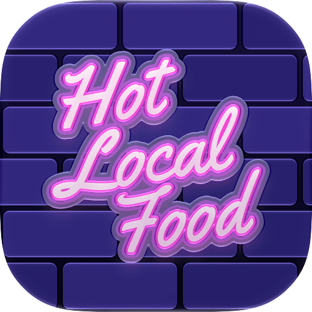

# Hot Local Food: Find Dinner

**Hot Local Food in Your Area**

It's like Tinder, but for food, and it already likes you back. Hot Local Food helps you filter the noise and find the food you crave: swipe through the restaurants around you until you find your perfect match.

“The future of finding your next meal”

[Download on the App Store](https://apps.apple.com/us/app/hot-local-food/id1621818779)

## Features

- **Swipe:** when you're out, see restaurants nearby and swipe until you find your perfect match. Swiped too fast? Undo brings the last card back.
- **Travel:** going somewhere? Pan the map to the area you plan to visit and get to know what's good before you get there.
- **Filters:** by category, currently open, price, and location.
- **Lists:** custom lists to save places for later, synced across your devices with iCloud.
- **Shortcuts:** make a reservation with OpenTable, order delivery or pickup with DoorDash or Uber Eats, call, or get directions.
- **Stats:** the places you've swiped on most, in each direction.

For vegans, carnivores, and everyone in between, Hot Local Food is the best place to find what you love, so you can eat it.

Free, hot, and available on iPhone with iOS 26 and newer. A one-time purchase removes the ads.

## How it's built

Swift 6 and SwiftUI, with one third-party dependency, the Google Mobile Ads SDK, for the banner ad. It requires iOS 26.

| Folder | Holds |
| --- | --- |
| `HLFIYA/HLFIYAApp.swift`, `ContentView.swift` | The app's entry point and its root view |
| `HLFIYA/Views` | The screens: the card deck, the map, filters, lists, restaurant details, and settings |
| `HLFIYA/Components` | Smaller pieces those screens share, including the hand-drawn neon wordmark and the HOT and NOT stamps |
| `HLFIYA/Models` | `RestaurantFeed`, the `@Observable` deck you swipe through, plus filters and Yelp's response types |
| `HLFIYA/Services` | `BusinessFetcher`, the one client for the Yelp Fusion API, and location |
| `HLFIYA/Core Data` | Swipes and saved lists, in Core Data synced through CloudKit |
| `HLFIYA/StoreKit` | The Remove Ads purchase, with StoreKit 2 |
| `HLFIYA/Ads` | The AdMob banner |
| `HLFIYA/Utils` | Yelp's categories and prices, and links into delivery and reservation services |
| `HLFIYA/Screenshots` | A Debug-only mode that loads made-up restaurants for App Store screenshots |
| `HLFIYATests` | Unit tests, written with Swift Testing |

Restaurants come from the [Yelp Fusion API](https://docs.developer.yelp.com/docs/fusion-intro). Searches filter out grocery and convenience stores so only places to eat make the deck, and responses are cached on disk so a restaurant's details load once. The feed's layout is worked out in a plain `FeedArrangement` type, so it's tested on its own and fits every screen size, both displays of iPhone Duo included.

To build it yourself, create `HLFIYA/Secrets.xcconfig` (it's gitignored) with your own Yelp key:

```
YELP_API_KEY = your-key-here
```

## License

MIT. See [LICENSE](LICENSE). The Yellowtail font is used under its own license, in [Licenses](Licenses).
